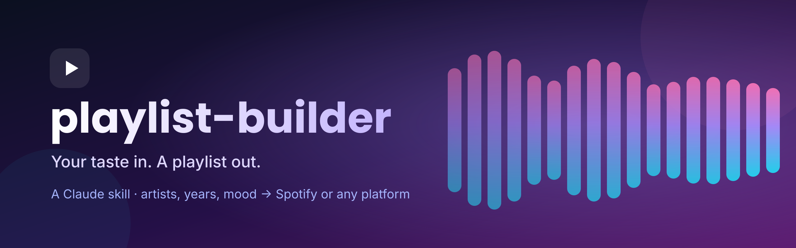

  

  
  
  
  

<h3 align="center">Tell Claude who you listen to. Get a playlist that actually fits.</h3>

A [Claude](https://claude.ai) skill that builds custom playlists from your **artists, years, genres and occasion**. No more scrolling through generic "chill mix" lists: you describe your taste, it builds the set, checks every track, and hands it over ready to play.

## Features

- **Built around you**: starts from the artists and years you love, then adds related discoveries so it is not just a copy of your library.
- **Spotify or anywhere else**: with the Spotify connector it creates the playlist and gives you the link. Without it, you get a clean `Artist - Title (year)` list to import on Apple Music, YouTube Music, Deezer and more.
- **Researched, not guessed**: before choosing, it checks which tracks work best for your occasion and years. If you say "club", it looks at what actually works in clubs, for each of your artists and for the era you picked.
- **Verified, never invented**: every track is looked up when a connector is available, and anything uncertain is dropped or flagged.
- **Flows like a playlist should**: ordered for energy and mood, with at most 2-3 tracks per artist.
- **Explains itself**: one line on why each track is there, so you can find new artists you would otherwise skip.

## How it works

| Step | What happens |
| --- | --- |
| **1. Tell** | Share 3-5 artists, the years or genres you like, the occasion and the length. Claude only asks for what is missing. |
| **2. Research** | Before picking anything, it checks which tracks of your artists perform best in your context (club, workout, road trip...) and in your years. |
| **3. Build** | About 60-70% of the set follows your artists, the rest are related finds that fit the same context and era. |
| **4. Check** | Every track is verified. On Spotify, only tracks that really exist end up in the playlist. |
| **5. Play** | You get the playlist link, or a list you can import anywhere. Then tweak it: "less slow", "more 90s". |

## Example

> Build me a study playlist: I like Pink Floyd, Radiohead and Nick Drake, mostly from the 70s and 90s, about 25 tracks.

Shortened sample of the kind of answer you get:

| # | Track | Why it is here |
| --- | --- | --- |
| 1 | Nick Drake - Northern Sky (1970) | Warm, unhurried opener that sets a focused mood |
| 2 | Pink Floyd - Breathe (In the Air) (1973) | Slow build, nothing that grabs your attention |
| 3 | Radiohead - Let Down (1997) | Layered guitars keep the energy moving gently |
| 4 | Nick Drake - Pink Moon (1972) | Sparse and quiet, good for deep reading |
| 5 | Pink Floyd - Wish You Were Here (1975) | A familiar anchor in the middle of the set |
| 6 | Radiohead - No Surprises (1997) | Soft landing before the next stretch |

## Installation

1. Download this repository (or clone it).
2. In Claude, open the skills settings and upload the repository folder, or paste the contents of [`SKILL.md`](SKILL.md) into a new skill.
3. Optional: connect the Spotify connector so playlists are created automatically.

Then just ask for a playlist, for example:

- "Make me a playlist for a long drive, I like Fleetwood Mac and Tom Petty."
- "I want a 90s Italian pop workout mix, about 40 minutes."

## Languages

The skill replies in the language you write in.

## Contributing

Ideas and improvements are welcome: open an issue or a pull request. Good places to start are new platforms to import to, better ways of ordering tracks, and mood presets.

## License

MIT, see [`LICENSE`](LICENSE).
